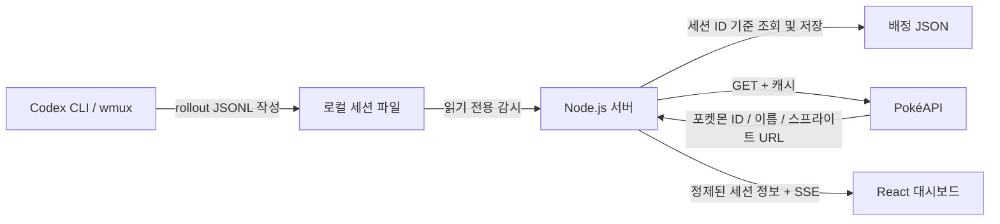

# Codex Poké Office

> 여러 Codex CLI 세션을 랜덤 포켓몬으로 표현하는 로컬 픽셀 아트 작업실

**Repository:** `codex-poke-office`  
**Local path:** `D:\01_Programming\08_AI\Agent\codex-poke-office`  
**Environment:** Windows 11 · wmux · Codex CLI · Node.js · React · TypeScript  
**Status:** 기획 문서 및 디렉터리 골격 작성 완료 / 애플리케이션 미구현

## 프로젝트 목적

여러 터미널에서 실행 중인 Codex CLI 세션을 한 화면에서 관찰합니다. 각 세션은 무작위로 배정된 포켓몬 캐릭터로 등장하며, 세션의 로그 이벤트와 최근 관측 시각을 시각적으로 확인할 수 있습니다.

Codex를 실행하거나 복원할 때 모니터링 화면에서 세션을 발견하도록 구성합니다. Codex·wmux의 실행 방식은 변경하지 않으며, 사용자는 기존 터미널에서 작업을 계속합니다.

## 기능 범위

| 기능 | 요구사항 |
|---|---|
| 세션 발견 | 로컬 Codex JSONL 세션 기록을 재귀 탐색하여 신규 세션 식별 |
| 복수 세션 | 발견한 세션을 한 화면에 동시에 표시 |
| 포켓몬 배정 | 각 세션에 무작위 포켓몬 한 마리 배정 |
| 배정 유지 | 동일한 세션 ID에는 재실행·`codex resume` 후에도 같은 포켓몬 유지 |
| 활동 표시 | 로그에서 **실제로 관측한 이벤트**와 마지막 관측 시간만 표시 |
| 캐릭터 반응 | 관측한 이벤트에 따라 걷기·대기·반응 등 가벼운 애니메이션 표현 |
| 상세 정보 | 프로젝트명, 세션 ID 축약본, 포켓몬 이름, 마지막 관측 시각 |
| 동기화 | 대시보드 새로고침 없이 변경 정보 반영 |
| 로컬 저장 | 세션 ID와 포켓몬 ID의 대응 관계만 별도 파일에 영속화 |
| 오류 처리 | 로그 파일 손상·API 실패·스프라이트 부재에도 전체 화면 유지 |

### 상태 표시 원칙

Codex 세션 JSONL은 **프로세스 생존 상태를 보장하는 신호가 아닙니다.** 실제 근거가 없는 `실행 중`, `승인 대기`, `작업 실패` 같은 단정적 라벨을 사용하지 않습니다.

- **최근 활동 감지:** 새로운 로그 기록이 관측됨
- **응답 완료 기록:** 버전별 로그에서 완료 이벤트를 확실히 판별한 경우에만 표시
- **새 기록 없음:** 일정 시간 로그 변화가 없음. 프로세스 종료를 뜻하지 않음
- **상태 미확인:** 로그 파싱 실패 또는 판별 불가

화면에 표시하는 상태와 내부 판별 기준은 실제 Codex JSONL 샘플로 먼저 검증합니다. 일부 이벤트를 해석할 수 없는 경우에도 로그의 수정 시각은 별도 표시합니다.

## 기술 구성

| 영역 | 기술 | 역할 |
|---|---|---|
| Frontend | React + TypeScript + Vite | 픽셀 사무실, 포켓몬 렌더링, 세션 상세 |
| Local server | Node.js + TypeScript | 세션 파일 탐색, 이벤트 파싱, 로컬 API |
| Live updates | Server-Sent Events (SSE) | 서버 → 브라우저 단방향 변경 알림 |
| Source | `%USERPROFILE%\.codex\sessions` | Codex 세션 JSONL 읽기 전용 |
| Pokémon data | [PokéAPI v2](https://pokeapi.co/docs/v2) | 포켓몬 이름 및 스프라이트 URL |
| Persistence | 로컬 JSON 파일 | 세션↔포켓몬 배정 상태 |

`CODEX_HOME`이 설정되어 있다면 그 위치의 `sessions` 디렉터리를 우선합니다. 구현 단계에서 이 동작을 확인합니다.

### 데이터 흐름



로컬 세션 로그 원문, 프롬프트, 도구 인수, 전체 작업 경로는 브라우저나 PokéAPI에 전송하지 않습니다.

## 핵심 동작

1. 서버가 Codex 세션 디렉터리를 읽기 전용으로 탐색합니다.
2. JSONL의 검증 가능한 세션 메타데이터에서 세션 ID와 프로젝트 경로를 추출합니다.
3. 최초 발견한 세션에 포켓몬을 무작위 배정하고 매핑을 저장합니다.
4. 이미 저장된 세션 ID는 기존 포켓몬을 재사용합니다.
5. 로그에서 새로운 기록을 관측하면 서버가 정제된 상태를 전송합니다.
6. 브라우저가 해당 포켓몬의 애니메이션과 카드 정보를 갱신합니다.

오래된 기록을 현재 실행 중인 세션으로 오인하지 않도록 최근 관측 시간 기준으로 기본 표시 목록을 제한합니다. 이미 실행 중인 세션은 대시보드를 다시 켜더라도 자동으로 발견해야 합니다.

## 화면 구성

- **상단:** 서비스명, 세션 수, 서버 연결 상태, 마지막 갱신 시간
- **중앙:** 포켓몬들이 배치되는 2D 픽셀 사무실
- **하단 또는 우측:** 선택한 세션의 프로젝트명·세션 ID·포켓몬·관측 상태
- **빈 화면:** 세션 미발견 / 연결 끊김 / 포켓몬 API 오류를 구분한 안내

세부 배치, 타이포그래피, 반응형 기준은 [`DESIGN.md`](./DESIGN.md)를 따릅니다.

## 디렉터리 구조

```text
codex-poke-office/
├── README.md
├── AGENTS.md
├── DESIGN.md
├── CODEX_TASK.md
├── .env.example
├── .editorconfig
├── .gitignore
├── docs/
│   └── PROJECT_STRUCTURE.md
├── client/
│   └── src/
│       ├── app/
│       ├── components/
│       └── styles/
├── server/
│   └── src/
│       ├── api/
│       ├── codex/
│       └── storage/
├── shared/
├── tests/
│   └── fixtures/
└── data/
```

현재 하위 디렉터리에는 빈 폴더를 Git에 보존하기 위한 `.gitkeep`만 들어 있습니다. **서버, 프론트엔드, 패키지 설정과 실행 스크립트는 아직 구현되지 않았습니다.** 담당 Codex가 `CODEX_TASK.md`에 따라 생성합니다.

## 개발 시작

1. ZIP을 `D:\01_Programming\08_AI\Agent\codex-poke-office`에 압축 해제합니다.
2. 해당 폴더에서 Codex CLI를 실행합니다.
3. `AGENTS.md` 및 [`CODEX_TASK.md`](./CODEX_TASK.md)의 구현 지시를 따릅니다.
4. 구현 완료 시 `npm install`, `npm run dev`로 로컬에서 실행 가능하도록 구성합니다.

> 현시점의 압축 파일은 **기획·설계 및 프로젝트 골격**입니다. `npm run dev`는 아직 실행할 수 없습니다.

## 보안·운영 제약

- Codex JSONL, Codex 설정, wmux 설정을 수정·이동·삭제하지 않습니다.
- 로컬 서버는 `127.0.0.1`에만 바인딩합니다.
- 클라이언트에 로그 원문, 계정 정보, 도구 호출 인수를 전달하지 않습니다.
- 승인·명령 실행·세션 종료 같은 제어 기능은 구현하지 않습니다.
- 포켓몬 이미지 파일을 저장소에 복제하거나 번들에 포함하지 않습니다.
- 포켓몬 이미지의 권리·상표는 API 이용 허가와 별개이므로 공개 배포 전 별도로 검토합니다.

## 구현 완료 기준

- 서로 다른 Codex 세션 2개 이상을 한 화면에서 식별할 수 있습니다.
- 대시보드를 켠 상태에서 새 Codex 세션을 실행하면 새 포켓몬이 표시됩니다.
- 동일 세션을 `codex resume`으로 복원해도 포켓몬 ID가 변하지 않습니다.
- 화면 새로고침 및 서버 재시작 후에도 세션↔포켓몬 매핑이 유지됩니다.
- 오래된 세션을 현재 실행 중으로 오인하지 않습니다.
- 비정상·부분 JSONL 레코드, API 장애, 누락된 스프라이트가 전체 앱을 중단시키지 않습니다.
- 네트워크 응답 및 브라우저 개발자 도구에 대화 원문이 노출되지 않습니다.
- 기존 Codex/wmux 환경이 변경되지 않습니다.

## 참고 자료

- [Codex GitHub — JSONL 기록 구현](https://github.com/openai/codex/blob/main/codex-rs/rollout/src/recorder.rs)
- [PokéAPI v2 문서](https://pokeapi.co/docs/v2)
- [PokéAPI 스프라이트 저장소 구조](https://github.com/PokeAPI/sprites)
