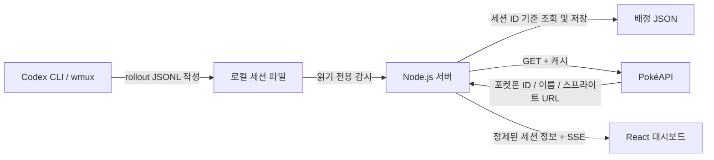

# Codex Poké Office

> 직접 탐험하며 고정 심볼로 배치된 Codex 세션 포켓몬을 만나는 로컬 도트 사파리

**Repository:** `codex-poke-office`  
**Local path:** `D:\01_Programming\08_AI\Agent\codex-poke-office`  
**Environment:** Windows 11 · wmux · Codex CLI · Node.js · React · TypeScript  
**Status:** 초기 구현 및 실제 로컬 세션 대시보드 검증 완료

## 프로젝트 목적

여러 터미널에서 실행 중인 Codex CLI 세션을 한 화면에서 관찰합니다. 각 세션은 무작위로 배정된 포켓몬 캐릭터로 등장하며, 세션의 로그 이벤트와 최근 관측 시각을 시각적으로 확인할 수 있습니다.

Codex를 실행하거나 복원할 때 모니터링 화면에서 세션을 발견하도록 구성합니다. Codex·wmux의 실행 방식은 변경하지 않으며, 사용자는 기존 터미널에서 작업을 계속합니다.

## 기능 범위

| 기능 | 요구사항 |
|---|---|
| 세션 발견 | 로컬 Codex JSONL 세션 기록을 재귀 탐색하여 신규 세션 식별 |
| 복수 세션 | 발견한 세션을 한 화면에 동시에 표시 |
| 포켓몬 배정 | 각 세션에 무작위 포켓몬 한 마리 배정 |
| 배정 유지 | 동일한 세션 ID에는 재실행·`codex resume` 후에도 같은 포켓몬 유지 |
| 활동 표시 | 로그에서 **실제로 관측한 이벤트**와 마지막 관측 시간만 표시 |
| 캐릭터 움직임 | 제공되는 도트 GIF를 탐험 지도와 인카운터에 표시, 모션 감소·비활성 탭에서는 정지 |
| 상세 정보 | 프로젝트명, 세션 ID 축약본, 포켓몬 이름, 마지막 관측 시각 |
| 동기화 | 대시보드 새로고침 없이 변경 정보 반영 |
| 로컬 저장 | 세션 ID와 포켓몬 ID의 대응 관계만 별도 파일에 영속화 |
| 오류 처리 | 로그 파일 손상·API 실패·스프라이트 부재에도 전체 화면 유지 |
| 사용 여부 | Windows에서 JSONL을 연 Codex 프로세스 확인, `사용 중 / 사용 안 함 / 확인 불가` 표시 |
| 놓아주기 | 선택·확인한 미사용 세션의 원본 JSONL 영구 삭제, 열린 기록과 확인 불가 기록 보호 |

### 상태 표시 원칙

Codex 세션 JSONL은 **프로세스 생존 상태를 보장하는 신호가 아닙니다.** 실제 근거가 없는 `실행 중`, `승인 대기`, `작업 실패` 같은 단정적 라벨을 사용하지 않습니다.

- **최근 활동 감지:** 새로운 로그 기록이 관측됨
- **응답 완료 기록:** 버전별 로그에서 완료 이벤트를 확실히 판별한 경우에만 표시
- **새 기록 없음:** 일정 시간 로그 변화가 없음. 프로세스 종료를 뜻하지 않음
- **상태 미확인:** 로그 파싱 실패 또는 판별 불가

화면에 표시하는 상태와 내부 판별 기준은 실제 Codex JSONL 샘플로 먼저 검증합니다. 일부 이벤트를 해석할 수 없는 경우에도 로그의 수정 시각은 별도 표시합니다.

## 기술 구성

| 영역 | 기술 | 역할 |
|---|---|---|
| Frontend | React + TypeScript + Vite | 사파리 탐험, 고정 심볼 인카운터, 세션 상세 |
| Local server | Node.js + TypeScript | 세션 파일 탐색, 이벤트 파싱, 로컬 API |
| Live updates | Server-Sent Events (SSE) | 서버 → 브라우저 단방향 변경 알림 |
| Source | `%USERPROFILE%\.codex\sessions` | Codex 세션 JSONL 읽기 전용 |
| Pokémon data | [PokéAPI v2](https://pokeapi.co/docs/v2) | 포켓몬 이름 및 스프라이트 URL |
| Persistence | 로컬 JSON 파일 | 세션↔포켓몬 배정 상태 |

`CODEX_HOME`이 설정되어 있다면 그 위치의 `sessions` 디렉터리를 우선합니다. 비어 있으면 사용자 홈의 `.codex/sessions`를 읽습니다. 별도 서버 라이브러리 없이 Node.js 내장 HTTP·파일 API를 사용합니다.

### 데이터 흐름



로컬 세션 로그 원문, 프롬프트, 도구 인수, 전체 작업 경로는 브라우저나 PokéAPI에 전송하지 않습니다.

## 핵심 동작

1. 서버가 Codex 세션 디렉터리를 읽기 전용으로 탐색합니다.
2. JSONL의 검증 가능한 세션 메타데이터에서 세션 ID와 프로젝트 경로를 추출합니다.
3. 최초 발견한 세션에 포켓몬을 무작위 배정하고 매핑을 저장합니다.
4. 이미 저장된 세션 ID는 기존 포켓몬을 재사용합니다.
5. 로그에서 새로운 기록을 관측하면 서버가 정제된 상태를 전송합니다.
6. 브라우저가 해당 포켓몬의 애니메이션과 카드 정보를 갱신합니다.

기본 목록은 최근 24시간 이내 **파일이 수정된** 기록입니다. `SESSION_LOOKBACK_HOURS`로 변경할 수 있습니다. 파일 수정 시각과 JSONL 이벤트 시각은 별도로 표시하며, 파일 크기가 늘어난 경우 마지막 읽기 위치 이후만 처리합니다. 디렉터리는 기본 2초마다 다시 탐색합니다.

세션 ID는 `session_meta.payload.id`의 UUID 형식을 확인한 후 사용합니다. 프로젝트명은 `cwd`의 마지막 디렉터리명만 전달합니다. 실제 로컬 기록에서 확인한 `event_msg.payload.type`의 `task_started`, `task_complete`, `turn_aborted`를 관측에 사용합니다. 마지막 이벤트가 60초 이내이면 최근 활동으로 표시하며, 완료 기록은 다음 시작·중단 기록 전까지 유지합니다. 손상되거나 아직 완성되지 않은 레코드는 상태 미확인으로 표시합니다.

최초 배정은 기본 도감 번호 1–1025 중 무작위로 선택하며 중복을 허용합니다. `data/assignments.json`에 배정을 먼저 저장하고 PokéAPI의 포켓몬·종 정보를 조회합니다. 종 정보의 한국어 이름과 스프라이트 URL만 `data/pokemon-cache.json`에 저장하며, 기존 영문 이름 캐시는 같은 ID의 한글 이름으로 갱신합니다. 조회 실패 시 `포켓몬 #번호`로 안내하고 1분 후 재시도합니다. 기존 스프라이트는 유지하며 이미지가 없으면 플레이스홀더를 표시합니다. GIF가 있으면 지도와 인카운터에서 움직이며, 모션 감소 설정·비활성 탭에서는 정적 이미지로 표시합니다. 움직임은 세션 사용 여부와 무관합니다.

## 화면 구성

- **상단:** 서비스명, 세션 수, 서버 연결 상태, 마지막 갱신 시간
- **중앙:** 플레이어가 이동하고 세션 포켓몬이 고정 심볼로 나타나는 도트 사파리
- **인카운터:** 선택한 세션의 프로젝트명·세션 ID·포켓몬·관측·사용 상태
- **빈 화면:** 세션 미발견 / 연결 끊김 / 포켓몬 API 오류를 구분한 안내

세부 배치, 타이포그래피, 반응형 기준은 [`DESIGN.md`](./DESIGN.md)를 따릅니다.

## 디렉터리 구조

```text
codex-poke-office/
├── README.md
├── AGENTS.md
├── DESIGN.md
├── CODEX_TASK.md
├── .env.example
├── .editorconfig
├── .gitignore
├── package.json / package-lock.json
├── tsconfig.json / vite.config.ts
├── docs/PROJECT_STRUCTURE.md
├── client/index.html
├── client/src/main.tsx
├── client/src/app/App.tsx
├── client/src/components/         # 사파리·캐릭터·인카운터·놓아주기 확인
├── client/src/styles/index.css
├── server/src/index.ts            # HTTP·SSE·주기적 탐색
├── server/src/config.ts           # 환경 변수 검증
├── server/src/codex/              # 탐색·증분 파싱·Windows 파일 사용 조회·삭제
├── server/src/storage/            # 배정·PokéAPI 캐시
├── shared/session.ts              # 공개 응답 타입
├── tests/sessions.test.ts         # 실제 서버 HTTP/SSE 통합 검증
└── data/                          # 실행 상태·검증 화면, Git 제외
```

모듈별 책임은 [`docs/PROJECT_STRUCTURE.md`](./docs/PROJECT_STRUCTURE.md)에 정리합니다. 참고용 `ai-office-main.zip`은 화면·좌석 선택 구성을 읽기 전용으로 검토했으며, Electron·Phaser 코드나 이미지 자산을 가져오지 않았습니다. 압축 파일은 Git에서 제외합니다.

## 로컬 실행

Node.js 24.10 이상과 npm이 필요합니다. 검증 환경은 Windows / PowerShell, Node.js 24.22.1, npm 11.17.0입니다.

```powershell
npm install
npm run dev
```

브라우저에서 `http://127.0.0.1:5173`을 엽니다. API는 `http://127.0.0.1:4100`입니다. 기존 터미널에서 Codex 작업을 계속하면 JSONL 변경이 자동 반영됩니다. 이 앱은 Codex나 wmux를 실행하지 않습니다.

선택적으로 `.env.example`을 `.env`로 복사해 포트·세션 위치·탐색 주기를 설정할 수 있습니다. `.env` 없이도 문서의 기본값으로 실행합니다. `HOST`는 `127.0.0.1`만 허용하며, 잘못된 숫자 설정이나 손상된 배정 저장 파일은 오류로 처리합니다. 새 포켓몬 정보를 조회하려면 PokéAPI에, 이미지를 표시하려면 GitHub 스프라이트 서버에 연결할 수 있어야 합니다.

```powershell
npm run check
npm test
npm run build
npm start
```

`check`는 TypeScript 검사, `test`는 임시 합성 JSONL과 실제 자식 서버를 사용하는 HTTP/SSE 통합 검증입니다. 실제 Codex 기록이나 프로세스는 건드리지 않습니다. `build` 결과는 `dist/`에 생성되며 `start`는 로컬 API와 빌드한 화면을 `http://127.0.0.1:4100`에서 제공합니다. 종료는 해당 실행 터미널의 `Ctrl+C`입니다.

## 사파리 탐험과 놓아주기

화면 이름은 **Codex Poké Office**입니다. 직접 플레이어를 조작해 **숲·늪지·사막·산봉우리·바위 해안·사바나** 6개 구역에서 세션 포켓몬을 만납니다. 세션 ID로 구역이 정해지며 포켓몬은 고정 심볼입니다. 구역 선택에는 표시 대상 수가 나오고 `모두 / 사용 중 / 사용 안 함`으로 필터링합니다.

- **이동:** 방향키·WASD 또는 화면 방향 버튼. 배경 드래그로 지도를 둘러보고 휠·± 버튼으로 확대·축소합니다. `전체 맵`은 구역 전체를 맞추고 `내 캐릭터`는 추적 상태로 돌아옵니다.
- **캐릭터:** 휘웅·봄이 중 선택하며 선택은 브라우저에 저장합니다. 걷기와 인카운터 모두 같은 캐릭터를 사용하고 원본 시트의 초록 배경은 투명 처리합니다.
- **만남:** 마우스 클릭은 거리와 관계없이 세션 정보를 엽니다. E키·말 걸기는 가까운 심볼에 동작합니다. 포켓몬은 플레이어보다 앞에 그려지고 맵 배율에 맞춰 커집니다.
- **인카운터:** `탐험으로 돌아가기 / 정보 보기 / 세션 ID 복사 / 포켓몬 놓아주기` 네 칸 메뉴를 제공합니다. 메타데이터와 상태·삭제 안내는 `정보 보기`에서 펼칩니다. 돌아가기·Escape로 탐험을 이어갑니다. HP·레벨·전투 기능은 없습니다.
- **놓아주기:** 사용 안 함으로 확인된 포켓몬의 버튼을 누르고 최종 확인하면 해당 세션 ID의 JSONL 원본을 영구 삭제합니다. 취소하면 보존합니다.

사용 여부는 로그 시각과 별개입니다. Windows Restart Manager가 JSONL을 연 `codex` 프로세스를 찾으면 `사용 중`, 열린 프로세스가 없으면 `사용 안 함`, 조회 권한 부족·오류·다른 프로그램 사용은 `확인 불가`입니다. 서버는 삭제 직전에 사용 여부·세션 ID·세션 폴더 내부 경로를 다시 확인하고 독점 접근을 확보합니다. **사용 중·확인 불가 세션은 삭제할 수 없습니다. 삭제한 원본으로는 대화를 이어갈 수 없으며, 공유 색인·DB는 변경하지 않으므로 Codex 목록 메타데이터는 남을 수 있습니다.**

기본 관리 대상은 `SESSION_LOOKBACK_HOURS=24` 이내 수정된 기록입니다. 더 오래된 기록을 보려면 기존 환경 변수의 시간을 늘립니다. 일괄 삭제와 전체 과거 기록 전용 화면은 추가하지 않았습니다.

맵은 이번에 built-in `image_gen`으로 새로 만든 일반 도트 지형이며 `client/public/maps/`에 포함합니다. 이전 Serebii 게임 스크린샷은 제거했고 배경에 미리 그려진 사람·포켓몬·UI는 없습니다. 제작 프롬프트와 출력 경로는 [`docs/map-prompts.json`](./docs/map-prompts.json)에 기록합니다. 인카운터 배경은 [Pokémon Showdown](https://play.pokemonshowdown.com/fx/), 트레이너는 [pret/pokeemerald](https://github.com/pret/pokeemerald/tree/master/graphics/object_events/pics/people/brendan), 포켓몬은 PokéAPI 도트 스프라이트를 외부 로딩합니다. 이 외부 자산 원본은 저장소·번들에 넣지 않으며 인터넷 연결이 필요합니다. HOME 렌더는 사용하지 않습니다.

2026-11-07 직접 확인한 결과:

- 실제 최근 세션 21개가 6개 구역에 분산되고 각 맵 이미지가 정상 로딩됨. 현재 대화의 사용 중 표시 확인.
- 방향키 이동·화면 방향 버튼·근접 E키 인카운터·탐험 복귀 확인. 이동 전후 심볼 위치 동일.
- 너비 1440 / 390 / 320px에서 가로·세로 페이지 스크롤 없이 이동 가능.
- 실제 대화에서는 사용 여부와 삭제 버튼 보호만 확인하고 원본 삭제는 수행하지 않음.
- 별도 합성 서버의 브라우저에서 탐험 → 근접 만남 → 놓아주기 확인 → 취소 시 보존 → 최종 확인 시 삭제·인카운터 종료 확인.
- HTTP 통합 검증에서 열린 파일 보호, 확인 없는 요청·외부 Origin 거부, 동일 ID의 여러 파일 삭제, 다른 세션 보존, 폴더 밖 경로·다른 ID 삭제 차단 확인.
- 제목·헤더·브라우저 이름을 Office로 복원, 홍보성 부제 제거.
- 6개 로컬 맵과 NPC 없는 원본 확인. 1440 / 390 / 320px에서 전체 맵이 안내창에 가려지지 않고 스크롤 없이 표시됨.
- 마우스 드래그·휠·± 확대/축소·전체 맵·캐릭터 추적 복귀와 원거리 클릭 확인.
- 휘웅·봄이 선택, 새로고침 후 선택 유지, 초록 배경의 투명 알파와 캐릭터 본체 보존 확인.
- 실제 21개 이름의 한글 표기와 13개 GIF URL 확인. 합성 브라우저에서 지도 GIF·모션 감소 시 정적 이미지 전환 확인.
- 네 칸 메뉴, 정보 펼치기·접기, 전체 세션 ID 복사, 모바일 390 / 320px 메뉴 표시 확인. 메타데이터는 정보 보기 안에만 표시됨.
- 6개 지형을 굵은 도트와 단순한 색면으로 다시 제작해 스프라이트와 질감 차이를 줄임.

최신 검증 화면은 `data/office-korean-explore.png`, `data/office-four-actions.png`, `data/office-session-info.png`, `data/office-menu-390.png`, `data/office-menu-320.png`에 있습니다(Git 제외). 통합 검증은 `npm test`, 합성 브라우저 서버는 `npm run build` 후 `node tests/browser-fixture.ts`로 실행합니다(`http://127.0.0.1:4191`). Playwright MCP의 `browser_run_code_unsafe`에 `filename: tests/safari.browser.js`를 전달하면 합성 기록에서 이동·만남·취소·삭제를 재검증합니다. Windows 파일 사용 조회가 제한되는 샌드박스에서는 확인 불가로 표시되고 삭제가 차단됩니다.

현재 충돌은 큰 장애물을 사각형으로 처리하며 정밀 타일 충돌은 구현하지 않았습니다. 실제 `codex resume`과 새 Codex 프로세스 실행은 기존 프로세스를 조작하지 않는 조건에 따라 수행하지 않았습니다.

## 초기 버전에서 확인한 결과

2026-11-06 로컬 검증 결과입니다. 아래 실제 기록 검증과 합성 데이터 검증을 구분합니다.

| 검증 | 결과 |
|---|---|
| `npm install` | 승인된 최소 패키지 설치 완료 |
| `npm run check`, `npm test`, `npm run build` | 종료 코드 0, 통합 검증 1개 통과 |
| `npm start` + 빌드 화면 | 4100 포트에서 화면·JS·CSS 응답 200, health 정상, 브라우저 오류 0개 |
| 실제 Codex 기록 | 최근 기록 15개를 한 화면에서 선택 가능, 포켓몬 이미지 15개 로딩, 깨진 이미지 0개 |
| 실제 기록 + 서버 재시작·브라우저 새로고침 | 기존 15개 세션의 포켓몬 ID 모두 동일 |
| 브라우저 조작 | 클릭·Enter 선택과 상세 정보 일치, 최근 활동 필터 동작 |
| 화면 너비 1440 / 390 / 320px | 가로 넘침 없음, 모든 좌석 선택 가능 |
| 모션 줄이기 | GIF 대신 정적 이미지 표시 |
| 신규·동일 ID·오래된 기록 | 합성 JSONL로 SSE 추가, 중복 방지, 동일 배정, 25시간 지난 기록 제외 확인 |
| 손상·부분 레코드·API 장애 | 합성 기록으로 상태 미확인·부분 레코드 복구·다른 세션 유지·배정 유지 확인 |
| 빈 사무실 | 브라우저 모의 응답으로 빈 메시지와 사무실·빈 책상 유지 확인 |
| 민감 정보 | HTTP/SSE·저장 파일에 합성 비공개 본문 미포함, 실제 응답은 허용 필드와 프로젝트 마지막 이름만 포함 |
| 외부 요청 | 서버는 포켓몬 번호만 조회, 브라우저 외부 요청은 포켓몬 스프라이트로 한정 |

검증 화면은 Git에서 제외하는 `data/dashboard-desktop.png`, `data/dashboard-390.png`, `data/dashboard-320.png`, `data/dashboard-empty.png`에 있습니다. 통합 검증은 `npm test`로 다시 실행할 수 있습니다.

**미검증:** 실제 `codex resume` 명령과 새 Codex 프로세스 실행은 기존 환경·프로세스에 손대지 않는 조건에 따라 수행하지 않았습니다. 동일 ID가 다시 나타나는 경로는 합성 기록으로 확인했습니다. 다음 작업은 사용자가 기존 터미널에서 새 세션 생성·`codex resume`을 수행하며 화면의 등장과 배정 유지를 확인하는 것입니다. 대형 기록은 최초 1회 전체 읽기가 필요하고, 이후에는 증분으로 처리합니다.

## 보안·운영 제약

- Codex·wmux 설정과 프로세스는 변경하지 않습니다. 현재 사용자 요청으로 추가하는 ‘놓아주기’만 선택·확인한 미사용 세션 JSONL을 삭제하며, 공유 색인·DB는 변경하지 않습니다.
- 로컬 서버는 `127.0.0.1`에만 바인딩합니다.
- 클라이언트에 로그 원문, 계정 정보, 도구 호출 인수를 전달하지 않습니다.
- 승인·명령 실행·세션 종료 같은 제어 기능은 구현하지 않습니다.
- 포켓몬 이미지 파일을 저장소에 복제하거나 번들에 포함하지 않습니다.
- 포켓몬 이미지의 권리·상표는 API 이용 허가와 별개이므로 공개 배포 전 별도로 검토합니다.

## 구현 완료 기준

- 서로 다른 Codex 세션 2개 이상을 한 화면에서 식별할 수 있습니다.
- 대시보드를 켠 상태에서 새 Codex 세션을 실행하면 새 포켓몬이 표시됩니다.
- 동일 세션을 `codex resume`으로 복원해도 포켓몬 ID가 변하지 않습니다.
- 화면 새로고침 및 서버 재시작 후에도 세션↔포켓몬 매핑이 유지됩니다.
- 오래된 세션을 현재 실행 중으로 오인하지 않습니다.
- 비정상·부분 JSONL 레코드, API 장애, 누락된 스프라이트가 전체 앱을 중단시키지 않습니다.
- 네트워크 응답 및 브라우저 개발자 도구에 대화 원문이 노출되지 않습니다.
- 기존 Codex/wmux 환경이 변경되지 않습니다.

## 참고 자료

- [Codex GitHub — JSONL 기록 구현](https://github.com/openai/codex/blob/main/codex-rs/rollout/src/recorder.rs)
- [PokéAPI v2 문서](https://pokeapi.co/docs/v2)
- [PokéAPI 스프라이트 저장소 구조](https://github.com/PokeAPI/sprites)
